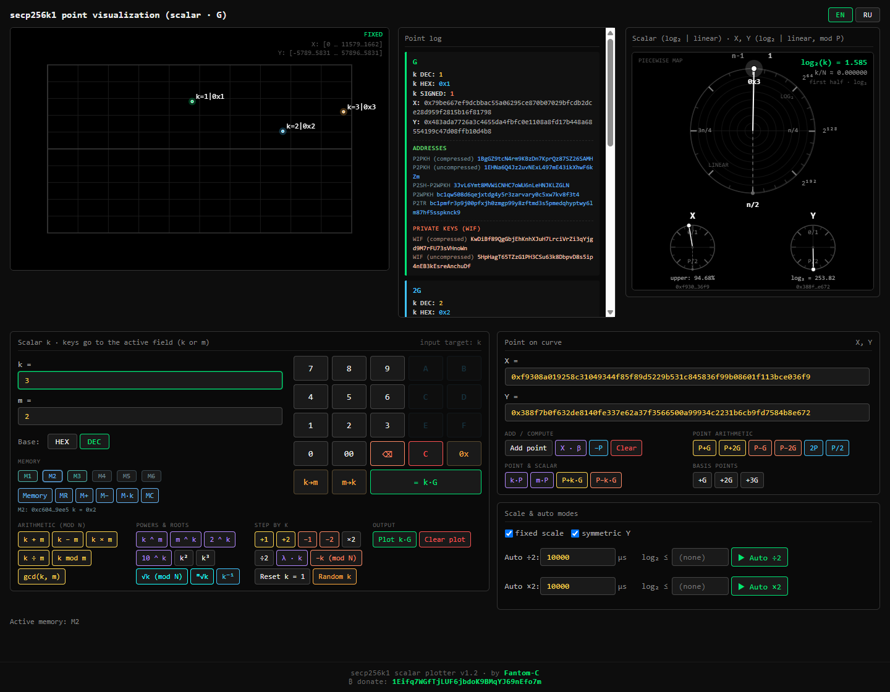

# secp256k1 Scalar Plotter

[English](#english) · [Русский](#русский)

Browser-only calculator and visualizer for **secp256k1** scalar operations.
No build, no server, no external dependencies.

---

## English

Browser-only **secp256k1** scalar calculator and point visualizer. Single self-contained HTML file: no build step, no server, no CDN.

### Features

- **Scalar `k`**: `k·G`, `k ± m`, `k × m`, `k ÷ m`, `k mod m`, `gcd(k, m)`, `k^m`, `m^k`, `2^k`, `10^k`, `k²`, `k³`, `√k (mod N)`, `ᵐ√k`, `k⁻¹`, `−k`, `λ·k`.
- **Cryptographically strong random `k`** (`crypto.getRandomValues`, rejection sampling in `[1, N−1]`).
- **On-screen keypad** for `k` and `m`: `0–9`, `A–F`, `⌫`, `C`, `0x`, `k→m`, `m→k`, HEX/DEC.
- **Point operations**: `P±G`, `P±2G`, `2P`, `P/2`, `k·P`, `m·P`, `P±k·G`, `X·β`; manual `X`/`Y` input with **automatic Y calculation** (enter X → Y is derived as the symmetric root) and on-curve validation.
- **Point log** with `k` (DEC/HEX/SIGNED), `X`, `Y` and Bitcoin data:
  - **P2PKH** (compressed/uncompressed), **P2SH-P2WPKH**, **P2WPKH**, **P2TR**;
  - **WIF** private keys (compressed/uncompressed) when the point scalar is known;
  - addresses open on Blockchain.com, WIF copies to clipboard on click.
- **Visualization**: point plot, logarithmic scalar ring, `X`/`Y` rings.
- **Interface**: English/Russian (English by default), responsive layout.

### Run

Open `calc.html` (or `index.html`) in a browser. Nothing else is required.

### Security warning

The app displays **private keys (WIF)**. Everything runs locally in your browser, but use it responsibly: never publish generated private keys, do not store real funds on browser-generated keys without understanding the risks, and prefer hardware/offline wallets for real money.

### Donations

If you find this project useful, you can support it:
**Bitcoin (BTC):** `1Eifq7WGfTjLUF6jbdoK9BMqYJ69nEfo7m`

### License

[MIT](LICENSE)

---

## Русский

Одностраничный калькулятор и визуализатор скалярных операций над **secp256k1**.
Один самодостаточный HTML-файл: без сборки, сервера и CDN.

### Возможности

- **Скаляр `k`**: `k·G`, `k ± m`, `k × m`, `k ÷ m`, `k mod m`, `gcd(k, m)`, `k^m`, `m^k`, `2^k`, `10^k`, `k²`, `k³`, `√k (mod N)`, `ᵐ√k`, `k⁻¹`, `−k`, `λ·k`.
- **Криптостойкий случайный `k`** (`crypto.getRandomValues`, rejection sampling в `[1, N−1]`).
- **Экранная клавиатура** для `k` и `m`: `0–9`, `A–F`, `⌫`, `C`, `0x`, `k→m`, `m→k`, HEX/DEC.
- **Операции с точкой**: `P±G`, `P±2G`, `2P`, `P/2`, `k·P`, `m·P`, `P±k·G`, `X·β`, ручной ввод `X`/`Y` с **автоматическим расчётом Y** (по `X` вычисляется Y как симметричный корень) и проверкой принадлежности точки кривой.
- **Лог точек** с `k` (DEC/HEX/SIGNED), `X`, `Y` и данными Bitcoin:
  - **P2PKH** (compressed/uncompressed), **P2SH-P2WPKH**, **P2WPKH**, **P2TR**;
  - **WIF** приватные ключи (compressed/uncompressed), если скаляр точки известен;
  - адреса открываются на Blockchain.com, WIF копируется по клику.
- **Визуализация**: график точек, логарифмическая круговая шкала скаляра, шкалы `X`/`Y`.
- **Интерфейс**: English/Русский (по умолчанию English), адаптивная вёрстка.

### Запуск

Откройте `calc.html` (или `index.html`) в браузере — больше ничего не нужно.

### Безопасность

Приложение показывает **приватные ключи (WIF)**. Всё работает локально в браузере, но используйте ответственно: не публикуйте сгенерированные ключи, не храните реальные средства на ключах, созданных в браузере, без понимания рисков, и предпочитайте аппаратные/офлайн-кошельки.

### Донаты

Если проект полезен, можно поддержать автора:
**Bitcoin (BTC):** `1Eifq7WGfTjLUF6jbdoK9BMqYJ69nEfo7m`

### Лицензия

[MIT](LICENSE)
